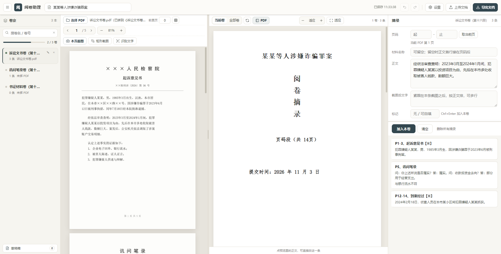
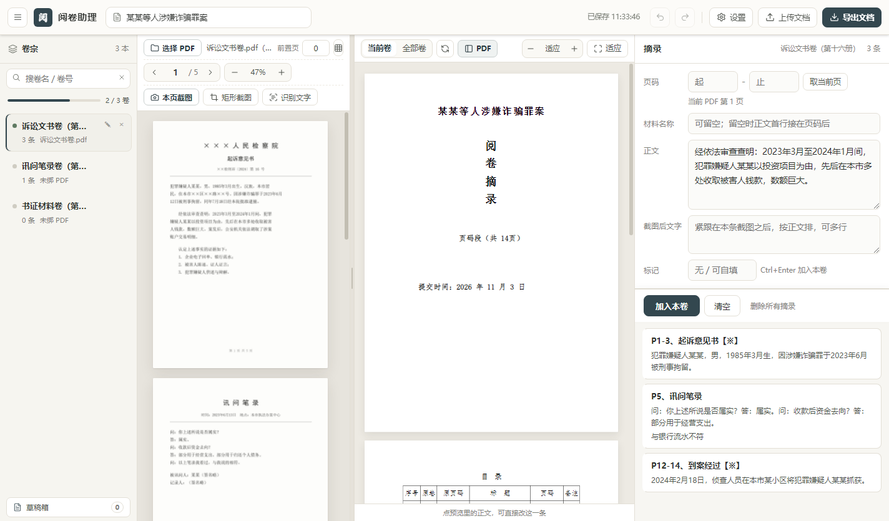
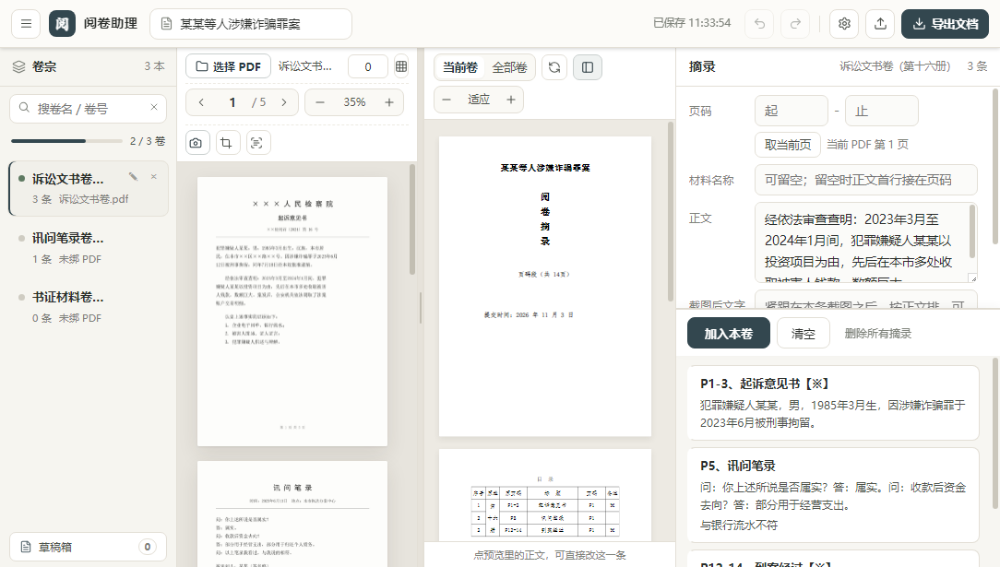

# 阅卷助理

**给刑辩律师的本地卷宗摘录工具** —— 打开电子卷宗 PDF，边看边摘，直接产出可交付的 A4 成文文档。

免注册 · 不联网 · 卷宗不出本机 · GPL-3.0 开源



---

## 为什么做这个

刑事案件的电子卷宗动辄十几册、上千页。要把供述、书证、到案经过整理成一份能交给法官或委托人看的《阅卷摘录》，通常得这么干：

1. 开着 PDF 阅读器，把内容一段段复制到 Word；
2. 手动记页码，抄错一个数字就得回头翻原卷；
3. 调格式、编目录、对页码，排版的时间比读卷的时间还长；
4. 案子材料敏感，不敢往在线工具里传。

**阅卷助理把这条路压缩成一条：在软件里看卷 → 摘录 → 导出。** 排版规则由软件按 A4 纸实尺寸算好，你在屏幕上看到的分页，就是导出 Word 后的分页。

## 它做什么

| 能力 | 说明 |
| --- | --- |
| **按卷管理** | 一次选多本 PDF 自动建卷，卷名/册号自动带出；左栏可搜索、看总进度 |
| **边看边摘** | 中栏读原卷，右栏填页码、材料名称、正文；支持整页截图、矩形截图 |
| **截图配文** | 截图后可以直接 OCR 识别成文字，识别结果跟截图绑在一起，不会变成孤立备注 |
| **标记疑点** | 给条目打【※】【？】等标记，导出时进目录备注列，方便庭审前二次核查 |
| **A4 所见即所得** | 右侧实时预览 210×297mm 成品，自动分页；支持自适应宽度和 0.2–3 倍手动缩放（Ctrl+滚轮） |
| **导出成文** | 一键生成 Word：封面（案名 + 竖排「阅卷摘录」+ 页码段 + 提交日期）+ 总目录 + 按卷排列的正文 |
| **目录对齐原卷** | 目录里的册号、原页码按卷宗实际编排，同册连续页码合并单元格 |
| **草稿箱** | 没提交的摘录自动暂存，换卷、换条目、关软件都不丢，回来一键放回表单 |
| **回收站** | 删掉的卷不直接销毁，可恢复；确认不要了再彻底删除 |

## 隐私：这是它的核心卖点，不是免责声明

- **免注册**：没有账号体系，没有激活码，下载即用。
- **不上传**：自有代码里没有任何对外网络请求，也不带自动更新。软件只在 `127.0.0.1` 起一个本地服务给自己渲染页面用。
- **数据只在本机**：卷宗不复制、不转存；摘录与截图存在本机 IndexedDB（`%APPDATA%\zhai-juan`）。数据目录是钉死的，换软件名、升级、重装都不会丢；要清就自己在设置里清。
- **OCR 也在本机**：识别走 Windows 自带的 `Windows.Media.Ocr` 引擎，不接任何第三方识别服务。
- **导出即成品**：生成的 Word 存到你选的目录，软件不留副本、不上传。

想自己核对的话，代码读三处就够了：

| 位置 | 事实 |
| --- | --- |
| `app.js:292` | 唯一的 PDF 入口 `getDocument({data:bytes})` —— 喂给它的是本地文件读出的字节，不是 URL |
| `app.js` 全文 | 无 `fetch` / `XMLHttpRequest` / `WebSocket` / `sendBeacon`；出现的 `url:` 全是 `URL.createObjectURL()` 生成的内存 blob |
| `main.js:31` | 数据目录钉在本机 `%APPDATA%\zhai-juan` |

内置的 pdf.js 作为通用库保留了远程加载能力，但本软件不向它传 URL，这条路径走不到。最硬的验证方式：**拔网线或用它跑一天**，功能完全不受影响。

一句话：**卷宗从始至终没离开过这台电脑。**

## 快速开始

### 直接运行（Windows）

从仓库的 **Releases** 页下载 `阅卷助理-win32-x64.zip`，解压后双击 `阅卷助理.exe`。不需要安装，不需要管理员权限，U 盘拷走也能跑。

### 从源码运行

```bash
npm install
npm start        # 启动软件
npm test         # 跑全部回归测试
npm run dist     # 打 Windows 包
```

### 自己打包

```bash
npx electron-packager . 阅卷助理 --platform=win32 --arch=x64 --icon=app.ico --overwrite --out=release
```

### 换新版（手动升级）

软件不联网，所以没有自动更新 —— 升级就是把新的文件夹替换掉旧的，摘录一条不会丢：

1. 顶栏 **设置** 里有**数据位置**（本机 `%APPDATA%\zhai-juan`）；当前版本号看菜单 **帮助 → 关于**。
2. 想更稳妥，点 **设置 → 完整备份（含截图）** 导出一份 `.zip`；新版本里用 **设置 → 恢复备份** 选中这个 `.zip` 就能原样装回。
3. 从 Releases 下新的 `阅卷助理-win32-x64.zip`，解压到一个新位置，双击 `阅卷助理.exe`。
4. 打开后确认版本号和卷列表都在，就可以把旧的解压文件夹删掉。

之所以能直接换：摘录和截图都存在 `%APPDATA%\zhai-juan`，软件把这个路径钉死在代码里（见 `main.js:31`），**跟 exe 放在哪、叫什么名无关**。旧文件夹里只有程序本身，没有你的数据。

（菜单 **文件 → 备份数据…** 是只备份文字的快捷入口，导出 `.json`，不含截图；要连截图一起带走就用设置面板里的完整备份。）

## 上手流程

1. 点「选择 PDF」，一次选中多本电子卷 → 自动按文件名建卷；
2. 点左栏任意一卷，中栏打开它的原卷；
3. 看到要摘的页，右栏填页码起止、材料名称，正文从 PDF 复制粘贴，或点「本页截图」「矩形截图」；
4. 按 `Ctrl+Enter` 加入本卷 —— 右侧 A4 预览立刻多出这一条；
5. 全部卷摘完，点右上「导出文档」，选保存位置，得到带封面和目录的 Word。

## 界面适配

按市面上主流笔记本/台式机分辨率做过实测渲染，四栏布局与 A4 预览宽度会随窗口自动收放：

`1100×680` · `1366×768` · `1440×900` · `1536×864` · `1920×1080` · `2560×1440`

窄屏下侧栏与编辑栏会逐级收窄，A4 预览保持整页可见。

| 1440×900 | 1100×680 |
| --- | --- |
|  |  |

## 已知限制

- 目前只出 **Windows x64** 包；macOS / Linux 需要自行打包（代码本身跨平台，未实测）。
- OCR 依赖系统里装有中文「光学字符识别」语言包（设置 → 时间和语言 → 语言），缺提示会直接告诉你怎么装。
- 扫描型 PDF 没有文字层时，正文靠截图 + OCR，识别结果需要人工校对后再进正式文书。
- 导出的目录是软件按 A4 分页算好后写进去的静态表格，**不需要在 Word 里刷新域**；只有页脚页码用了 Word 的 `PAGE` 域，打开即显示。

## 开发

```
阅卷助理.html      界面与样式（含内联 pdf.js worker，离线可用）
app.js             全部前端逻辑（卷管理 / 摘录 / A4 分页 / 导出）
main.js            Electron 主进程（本地服务、文件读写、OCR 调用）
preload.js         受控桥接，不开 nodeIntegration
lib/               pdf.js
ocr.ps1            Windows 本机 OCR 脚本
.build/            回归测试与打包脚本
```

回归测试（`.build/run_all.js` 逐个起 Electron，全部用合成数据 + 随机端口，不会碰你的真实卷宗）：

```bash
npm test
```

单独跑某一项也可以：

```bash
npx electron --no-sandbox --disable-gpu .build/test_a4_empty.js
npx electron --no-sandbox --disable-gpu .build/test_sidebar_clean.js
npx electron --no-sandbox --disable-gpu .build/test_ui.js
npx electron --no-sandbox --disable-gpu .build/test_ui_states.js
npx electron --no-sandbox --disable-gpu .build/test_drafts.js
npx electron --no-sandbox --disable-gpu .build/verify_release_ui.js
```

`.build/test5.pdf` 与 `.build/demo_case.pdf` 是合成演示卷，全部内容为「某某案」占位文本，可直接拿来做开发调试。

**改 A4 分页前请注意**：`.a4-body{height:246.2mm}` 同时驱动预览分页和 Word 导出分页，删掉或改动会让两边对不上。

## 参与

欢迎提 Issue 和 PR。改动请先跑上面那组回归测试，并附上多分辨率截图。

想加的功能、觉得难用的地方，直接开 Issue 说场景就行 —— 这个工具本来就是从真实阅卷流程里长出来的。

## 支持

软件永久免费、GPL-3.0 开源，不捐款不会少任何一个功能，也没有付费版。如果它确实帮你省下了翻卷排版的时间，可以扫个码支持一下：


捐赠不影响许可和版权归属，也不构成任何形式的商业服务承诺。

比捐赠更有用的支持是：**把你遇到的排版问题、缺的功能开成 Issue**，或者把你摸索出来的用法（比如扫描卷怎么截图配文最省事）写下来，帮下一位律师少走弯路。

## 许可

GPL-3.0-only，见 [LICENSE](LICENSE)。每个源码文件头部都带许可声明。

第三方组件：[pdf.js](https://mozilla.github.io/pdf.js/)（Apache-2.0）、Electron（MIT）。

## 免责

本软件是文书整理工具，不提供任何法律意见，也不校验摘录内容的法律准确性。生成的文书请务必人工复核后再对外提交。**使用者需自行确保对所处理的卷宗享有合法权限，并遵守所在地关于案件材料保密的规定。**
